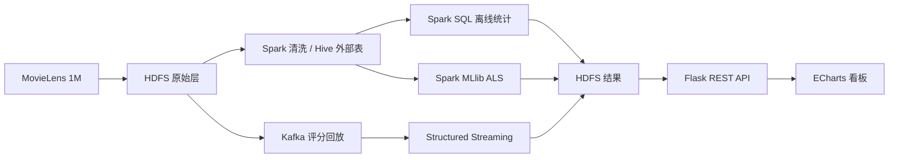

# MovieLens 电影评分分析与推荐

使用 Hadoop、Hive、Spark 和 Kafka 处理 MovieLens 1M，以 Flask API 和 ECharts 看板展示离线统计、历史评分回放、低分告警和个性化推荐。

## 快速启动

安装 **Git 和 Python 3.11 或更高版本**后，复制以下命令。首次启动会自动创建虚拟环境并安装 Flask。

```powershell
git clone https://github.com/AAaawwee/movielens-bigdata-dashboard-1.git
cd movielens-bigdata-dashboard-1
py -3.11 run.py
```

macOS 或 Linux 将最后一行换为 `python3 run.py`。已安装其他较新的 Python 版本时，在 Windows 也可运行 `py -3 run.py`。Linux 若缺少 `venv`，先安装所用 Python 版本对应的 `python3-venv` 软件包。

然后打开 [http://127.0.0.1:5066/](http://127.0.0.1:5066/)。端口被占用时可用 `py -3.11 run.py --port 5068`（macOS / Linux 使用 `python3`）。

仓库自带本项目已完成的结果快照。默认启动直接展示 **1,000,209 条评分的统计、10 张图表、最近 30 个历史窗口与 5 条告警**，并可查询 **6,040 位用户各 10 条已生成的 ALS 推荐**。输入用户 `1` 或 `6040` 即可验证。展示模式无需虚拟机、Hadoop、Spark、Kafka、数据下载、环境变量或重复训练。

| 运行方式 | 适用场景 |
| --- | --- |
| `run.py` | 直接查看已完成的项目结果，实时区域展示归档的历史回放快照 |
| `dashboard/app.py --mode cluster` | 接入已部署的集群，按当前 HDFS 结果展示并轮询。见 [连接现有集群](docs/deployment.md#连接现有集群) |
| Hadoop / Spark 流水线 | 复现入湖、清洗、训练和流式处理。见 [部署与复现](docs/deployment.md) 和 [VMware 三节点指南](docs/vmware.md) |

## 看板预览


## 功能

- **数据入湖**。原始评分、电影和用户数据写入 HDFS，经清洗后存为 Parquet，注册六张 Hive 外部表。
- **离线分析**。Spark SQL 统计影片、类型、用户、日期、小时和星级分布。看板包括月度评分趋势、每日活跃用户、影片热度与口碑散点图，以及可按年和季度切换的日历热力图。
- **ALS 推荐**。在 YARN 上训练并保存模型，为已有用户生成未评分影片 Top 10，可加载已有模型进行查询。
- **流式分析**。Kafka 按事件时间回放历史评分，Spark Structured Streaming 生成五分钟窗口，用 checkpoint 从中断处恢复，通过 `foreachBatch` 写入结果。Flask 每 5 秒响应页面轮询，在 Kafka 断开时继续显示最近快照。



## 目录

| 路径 | 用途 |
| --- | --- |
| [run.py](run.py) | 已完成结果的跨平台启动入口 |
| [dashboard/](dashboard/) | Flask 应用、前端模板、ECharts 和已完成的结果快照 |
| [pipeline/ingest/](pipeline/ingest/) | HDFS 入湖及 Spark 清洗 |
| [pipeline/sql/](pipeline/sql/) | Hive 六表 DDL |
| [pipeline/offline/](pipeline/offline/) | Spark SQL 离线统计 |
| [pipeline/als/](pipeline/als/) | Scala ALS 作业及 PySpark 版本 |
| [pipeline/streaming/](pipeline/streaming/) | Kafka 回放和 Structured Streaming |
| [infra/hadoop/](infra/hadoop/) | 三节点 Hadoop 配置模板 |
| [infra/vmware/](infra/vmware/) | 三台 VMware 的 `.vmx` 和磁盘对应表 |
| [verification/](verification/) | Hive、Kafka、页面回归核验 |
| [docs/](docs/) | 复现说明、验收结果和页面截图 |

## 接口

| GET 路径 | 返回数据 |
| --- | --- |
| `/api/overview` | 评分、影片、用户数 |
| `/api/offline/trend` | 月度趋势、平均分、每日评分量和活跃用户、评分分布与类型 |
| `/api/offline/hourly` | UTC 逐小时评分量 |
| `/api/offline/movie-scores` | 有至少 50 条评分的影片评分量和平均分 |
| `/api/movie/ranking` | 热门影片排行 |
| `/api/recommendations?user_id=1` | 指定用户的 ALS 推荐 |
| `/api/realtime` | 五分钟窗口、数据来源和连接状态 |
| `/api/alerts` | 最近快照的中、高度低分告警 |

## 验收结果

| 项目 | 项目原集群统计 |
| --- | --- |
| 数据量 | 1,000,209 条评分、3,883 部影片、6,040 位用户 |
| ALS | 60,400 条推荐。RMSE 0.8923，MAE 0.7097，测试评分覆盖率 52.19% |
| 流式分析 | 55,841 个有评分的五分钟窗口，原回放峰值约 15,409 条/秒 |
| 看板 | 8 个 API、10 个图表区。测试断开 Kafka 后仍显示最近 30 个有评分窗口 |

完整口径见 [验收记录](docs/verification.md)。

## 数据和来源

从 [GroupLens MovieLens 1M](https://grouplens.org/datasets/movielens/1m/) 获取原始数据，遵守 [数据使用许可](https://files.grouplens.org/datasets/movielens/ml-1m-README.txt)。仓库提供代码、截图和从本项目 HDFS 导出的展示结果，包括聚合统计、ALS 推荐和最后一次回放快照。原始评分、用户资料、清洗明细和 Kafka 消息由复现者通过官方数据和流水线生成。快照内容和导出方式见 [结果快照](dashboard/snapshots/README.md)。

此课程项目的技术路线参考 [Distributed Spark Movie Recommender](https://github.com/zubiiabbasi/distributed-spark-movielens-recommender)。随项目分发的 Apache ECharts 保留原 [LICENSE](dashboard/static/echarts-LICENSE.txt) 和 [NOTICE](dashboard/static/echarts-NOTICE.txt)。


## 新增课程演示模块

顶部标签页分别展示离线分析、ALS 推荐、实时回放、M1 相似电影、M2 用户画像及 M4 电影关系网。

- M1：RDD 累加器、广播、分区、缓存与余弦相似度，生成 23,900 条相似推荐。
- M2：Spark 通过 Hive Metastore 读取表，生成年月分区数据、CUBE、PIVOT、类型 Top10 和 7 日移动平均。整体评分总计为 1,000,209；多类型评分单独计数。
- M4：GraphX PageRank、标签传播、连通分量及邻居统计。采用共同喜欢人数至少 30、余弦相似度至少 0.15、任一方 Top10 邻居保留规则，结果为 1,400 个电影节点、9,632 对关系、31 个社区、1 个连通分量。前端展示 100 个节点。

运行入口：`pipeline/rdd/run-m1.sh`、`pipeline/sql/run-m2.sh`、`pipeline/graph/run-m4.sh`。M2 需要 `thrift://namenode:9083` Metastore；M4 读取 M1 结果，默认输出 `/movie/result/graph_v3`。所有作业拒绝覆盖已存在的正式输出。

新增接口：`/api/movie/similar?movie_id=260`、`/api/profile/age-genre`、`/api/profile/gender`、`/api/genre/top10?genre=Sci-Fi`、`/api/profile/daily`、`/api/graph`。

仓库快照已包含全部新增模块，按原快速启动方式即可离线演示。`scripts/export-snapshot.py` 从集群导出完整快照。

页面将历史事件时间映射至 2024 年 1 月至 2026 年 8 月，仅用于演示，并省略电影上映年份。时间轴经过压缩，日历显示日期和窗口时间为演示标签；原始数据、API 及统计口径保持不变，不能将展示时间作为真实采集日期。
